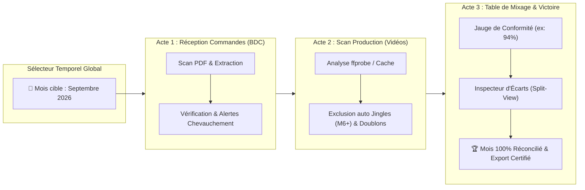

L’audit croisé du code source et des jeux de données de production (`convert_bdc_05-2026.json` à `09-2026.json` et `rapport-2026-05.json` à `09-2026.json`) met en évidence **14 failles logiques et structurelles** qui expliquent les faux positifs lors du rapprochement mensuel, ainsi qu'un cloisonnement applicatif qui alourdit inutilement la charge mentale de l'opérateur.

---

## LIVRABLE 1 : AUDIT D'INTÉGRITÉ MÉTIER & TABLEAU DES INCOHÉRENCES

### 1. Synthèse des anomalies détectées (Code & Données)

| Fichier & Fonction | Comportement actuel | Risque / Impact métier réel observé | Correction proposée |
| --- | --- | --- | --- |
| `apps/reporting/analyser.py` (`CategoryThresholds` & `categorize`)

 | `medium_lt = 420` (`d < 420`) et `long_ge = 420` mais testé avec un opérateur strict `if d > th.long_ge:`.

 | **Angle mort à `420.0s` (7m00s)** : `420.0 < 420` est `False` et `420.0 > 420` est `False`. La fonction tombe dans le `return "medium"` final au lieu de `"long"`.

 | Remplacer `if d > th.long_ge:` par `if d >= th.long_ge:` et supprimer le retour final redondant `"medium"`. |
| `apps/reporting/generate_report.py` (`main`) vs `apps/reporting/app.py` (`THRESHOLDS`)

 | Le CLI `generate_report.py` contourne le bug ci-dessus en fixant `long_ge=419`, tandis que le serveur Flask `app.py` utilise `long_ge=420`.

 | **Divergence CLI vs Web** : une vidéo de `419.5s` ou `420.0s` change de catégorie selon que le rapport est généré via CLI (`long` à `420.0s`) ou via l'interface web (`medium` à `420.0s`).

 | Unifier l'instance `DEFAULT_THRESHOLDS` dans `libs/schemas` et utiliser `>= 420` partout. |
| `libs/pipeline/bdc_to_batch.py` (`infer_category_from_description`) & BDC JSON

 | Les BDC stipulent `"entre 3 et 5 minutes"` (standard) et `"plus de 8 minutes"` (longue, ex. `BDC-26-0986`), alors que `analyser.py` coupe à `2-5 min` (`120-300s`), `5-7 min` (`300-420s`) et `>7 min` (`420s`). En fallback regex, le mot-clé `"moyen"` est rabattu sur `STANDARD` au lieu de `MEDIUM`.

 | **Conflit de grille tarifaire** : 1) Trou sémantique entre 2 et 3 min ; 2) Une vidéo de 7m30s est classée `long` côté reporting mais ne correspond pas à `"plus de 8 minutes"` côté BDC ; 3) Mauvais mapping de `MEDIUM` sur les libellés BDC atypiques.

 | Aligner les regex d'inférence par priorité stricte (`LONG` $\rightarrow$ `MEDIUM` $\rightarrow$ `STANDARD` $\rightarrow$ `SHORT`) et documenter la tolérance des paliers. |
| `apps/bdc_converter/convert_bdc.py` (`_extract_reference` & `LOT_REFERENCE_PATTERN`)

 | `LOT_REFERENCE_PATTERN = re.compile(r"^(?:LOTS?\s*)?[\d\s/,-]+$")` inclut le tiret `-`. Si elle matche, `re.findall(r"\d+", ...)` extrait uniquement les nombres et les joint par `/`.

 | **Destruction silencieuse des intervalles à tiret** : une référence PDF `"LOTS 38-92"` matche la regex et devient `"LOTS 38/92"` (`["LOTS 38", "92"]`), supprimant les 53 lots intermédiaires !

 | Retirer `-` de `LOT_REFERENCE_PATTERN` ou normaliser `(\d+)\s*(?:- |
| `apps/bdc_converter/convert_bdc.py` (`REFERENCE_SPLIT_PATTERN`)

 | Défini comme `re.compile(r"(?:/ | \|, | ; |
| `libs/reconciliation/comparison.py` & `convert_bdc_07/08/09-2026.json`<br> | Les BDC `BDC-26-1333` (`LOTS 38 à 92`), `BDC-26-1463` (`LOTS 135 à 188`) et `BDC-26-1482` (`LOTS 21 à 56`) utilisent des plages continues alors que la numérotation de production est éparse. De plus, en 09/2026, `BDC-26-1482` (`21 à 56`) chevauche `BDC-26-1479` (`21/23/26/27/31/33/36/39`).

 | **Explosion de faux positifs et double comptage** : l'expansion naïve `range(38, 93)` crée **37 lots fantômes** signalés manquants en juillet 2026. En septembre 2026, `BDC-26-1482` (`34` courtes, `14` standards) cumule en réalité les volumes de `BDC-26-1479` (`20` courtes, `9` standards) + les lots `41..56` (`14` courtes, `5` standards).

 | Filtrer l'expansion d'un intervalle `[A..B]` sur les `id_camille` existants dans `[A..B]` et détecter les collisions de lots entre deux BDC d'un même mois. |
| `apps/reporting/analyser.py` (`analyze_month` & `analyze_batch`)

 | Tri des groupes par `key=lambda x: int(x[0][0]) if x[0][0].isdigit() else x[0][0]`.

 | **Crash `TypeError` en Python 3** : si un lot est numérique (`"12"` $\rightarrow$ `int`) et un autre alphanumérique (`"12B"` $\rightarrow$ `str`), `sorted()` lève `TypeError: '<' not supported between instances of 'int' and 'str'`.

 | Retourner un tuple homogène : `key=lambda x: (0, int(x[0][0]), "") if x[0][0].isdigit() else (1, 0, x[0][0])`. |
| `apps/reporting/analyser.py` (`is_analyzable_video` & `rapport-2026-06/09.json`)

 | Filtre uniquement les noms exacts `{"m6+.mp4", "m6_plus.mp4"}` lors du scan des archives, mais pas dans `analyze_batch`.

 | **Pollution par les jingles M6+** : `rapport-2026-06.json` contient encore `"m6+.mp4"` dans les lots `110, 148, 179, 208, 233` (créant +1 courte d'écart sur 4 BDC !) et `rapport-2026-09.json` inclut `"m6+max anime.mp4"` dans le lot `63` (écart sur `BDC-26-1528`).

 | Utiliser une regex d'exclusion `^m6(?:+ |
| `apps/reporting/analyser.py` (`collect_video_entries`) & `rapport-2026-08.json`<br> | Aucune déduplication des fichiers vidéo extraits des sous-dossiers d'un même lot.

 | **Doublon de comptage** : dans `rapport-2026-08.json`, le lot `29` compte 2 fois `"CABANON_TAT_M6.mp4"`, faussant le cluster `BDC-26-1382` (`LOTS 29/32`).

 | Dédupliquer par nom de fichier normalisé (ou hash/taille) au sein d'un même `(id_camille, person)`. |
| `apps/reporting/analyser.py` (`categorize` & `analyze_batch`)

 | Si `ffprobe` et `*_scenes.csv` échouent (`duration_sec=None`), `categorize` renvoie `None` et la vidéo est ignorée sans log ni compteur d'erreur. Si un dossier n'a aucune vidéo valide, le lot est quand même émis avec `0` vidéo (ex. Lot `13` dans `rapport-2026-06.json`).

 | **Défaillance silencieuse** : écart entre `batch_meta.video_entries` et `total_mp4`, disparition muette de vidéos corrompues, et lots à `0` vidéo polluant le rapprochement (`Lot 13` en juin 2026).

 | Ajouter une liste `unclassified_files` / `warnings` au rapport et exclure ou signaler explicitement les lots à `0` vidéo. |
| `apps/reporting/app.py` (`load_monthly_batch_from_file`, `get_batch_for_month`, `month_options`)

 | `load_monthly_batch_from_file` est défini mais jamais appelé (code mort). `month_options` ignore son argument `batches_dir`. `get_batch_for_month` appelle toujours `create_batch_from_archives`.

 | **Rupture du pipeline BDC $\rightarrow$ Reporting** : le batch généré dans `data/batches/YYYY-MM.json` par `bdc_converter` n'est jamais lu par `reporting`, qui affiche un faux bandeau `"Batch JSON"` avec `0 commande`.

 | Connecter `get_batch_for_month` et `month_options` à `BATCHES_DIR` pour fusionner les commandes BDC avec le scan des archives. |
| `apps/reporting/generate_report.py` (`ARCHIVES_DIR`)

 | `ROOT = Path(__file__).parent` (`apps/reporting`) et `ARCHIVES_DIR = ROOT / "archives"`.

 | **Chemin cassé en CLI** : cherche `apps/reporting/archives` au lieu de `<repo_root>/archives` utilisé par `analyser.py` et `app.py`.

 | Remplacer par `ROOT = Path(__file__).resolve().parents[2]` ou importer `ARCHIVES_ROOT` depuis `analyser.py`. |
| `apps/bdc_converter/convert_bdc.py` (`convert_folder`) & `app.py` (`infer_bdc_month_year`)

 | `convert_folder` attrape toute `Exception` par un simple `print()` et retourne `processed_files = len(pdf_files)`. `infer_bdc_month_year` applique le mois majoritaire à tous les PDF du dossier.

 | **Perte silencieuse de BDC & mélange de mois** : un PDF illisible est compté comme traité ; si `pdfs/` contient des PDF de deux mois différents, ils sont fusionnés dans un unique JSON mensuel.

 | Retourner `failed_files` dans le payload JSON et grouper les exports par `(year, month)` de chaque BDC. |
| `apps/reconciliation/templates/index.html` & `export.html`<br> | `index.html` colore `delta >= 0` en vert (`text-positive`), `export.html` colore `delta >= 0` en vert et appelle `{{ meta.generated_at }}` (indéfini dans `app.py`).

 | **Contresens visuel comptable** : un écart de `+3` vidéos est affiché en vert comme s'il était conforme, et la date de génération est vide dans l'export HTML.

 | Colorer uniquement `delta == 0` en vert (`text-positive`), `delta != 0` en orange/rouge, et passer `analysis.generated_at`.

 |

---

### 2. Focus Code & Correctifs clés (Diffs prêts à l'emploi)

#### A. Correction des seuils temporels, du tri et du filtrage des jingles (`apps/reporting/analyser.py`)

```python
# apps/reporting/analyser.py
import re

EXCLUDED_VIDEO_PATTERN = re.compile(r"^m6(?:\+|_plus)", re.IGNORECASE)

def is_analyzable_video(video_path: Path) -> bool:
    """Exclut les non-.mp4 ainsi que toutes les variantes de jingles M6+ (ex: m6+max anime.mp4)."""
    if video_path.suffix.lower() not in ALLOWED_VIDEO_SUFFIXES:
        return False
    return not bool(EXCLUDED_VIDEO_PATTERN.match(video_path.name.strip()))

def normalize_lot_id(raw_id: str) -> str:
    """Normalise '004' -> '4' tout en préservant les identifiants alphanumériques."""
    cleaned = raw_id.strip()
    return str(int(cleaned)) if cleaned.isdigit() else cleaned

def lot_sort_key(item: Tuple[Tuple[str, str], list]) -> Tuple[int, int, str]:
    """Garantit l'absence de TypeError entre identifiants numériques et alphanumériques."""
    lot_id = normalize_lot_id(item[0][0])
    if lot_id.isdigit():
        return (0, int(lot_id), "")
    return (1, 0, lot_id)

def categorize(duration: Optional[float], th: CategoryThresholds) -> Optional[str]:
    if duration is None or duration < 0:
        return None
    if duration < th.short_lt:       # [0, 120[ -> < 2 min
        return "short"
    if duration < th.standard_lt:    # [120, 300[ -> 2 à 5 min
        return "standard"
    if duration < th.medium_lt:      # [300, 420[ -> 5 à 7 min
        return "medium"
    return "long"                    # >= 420s -> >= 7 min (corrige l'angle mort à 420.0s)

```

#### B. Sauvegarde des intervalles et correction de la Regex dans `apps/bdc_converter/convert_bdc.py`

Dans la version actuelle de `convert_bdc.py`, `LOT_REFERENCE_PATTERN` capture les tirets `-` et `re.findall(r"\d+", ...)` écrase les intervalles (ex. `LOTS 38-92` devient `LOTS 38/92`), tandis que `REFERENCE_SPLIT_PATTERN` contient un double antislash `\\b` qui casse la détection du mot `"et"` :

```python
# apps/bdc_converter/convert_bdc.py
REFERENCE_SPLIT_PATTERN = re.compile(r"(?:/|\\|,|;|\bet\b)", re.IGNORECASE)
RANGE_DETECT_PATTERN = re.compile(r"\b(\d+)\s*(?:à|au|-)\s*(\d+)\b", re.IGNORECASE)
# Ne pas inclure le tiret '-' dans LOT_REFERENCE_PATTERN pour ne pas écraser les intervalles "38-92"
LOT_REFERENCE_PATTERN = re.compile(r"^(?:LOTS?\s*)?[\d\s/,]+$", re.IGNORECASE)

def _extract_reference(text):
    match = REFERENCE_PATTERN.search(text)
    if not match:
        return None, []
    raw_lines = [line.strip() for line in match.group(1).splitlines() if line.strip()]
    first_line = raw_lines[0] if raw_lines else ""
    normalized = re.sub(r"\s{2,}", " ", first_line)
    cleaned_line = _clean_reference_line(normalized)
    candidate_line = cleaned_line or normalized

    # Normalise les intervalles "38-92" ou "38 au 92" en "38 à 92"
    if RANGE_DETECT_PATTERN.search(candidate_line) and "/" not in candidate_line:
         normalized_range = RANGE_DETECT_PATTERN.sub(r"\1 à \2", candidate_line)
         if not normalized_range.upper().startswith("LOT"):
             normalized_range = f"LOTS {normalized_range}"
         return normalized_range, [normalized_range]

    if LOT_REFERENCE_PATTERN.match(candidate_line):
        lot_numbers = [str(int(n)) for n in re.findall(r"\d+", candidate_line)]
        formatted_value, formatted_parts = _format_lot_reference(lot_numbers)
        if formatted_value:
            return formatted_value, formatted_parts
    # ... suite du découpage standard

```

#### C. Expansion intelligente des intervalles et détection des collisions de BDC (`libs/reconciliation/comparison.py`)

L'examen de `convert_bdc_07-2026.json` (`LOTS 38 à 92`), `convert_bdc_08-2026.json` (`LOTS 135 à 188`) et `convert_bdc_09-2026.json` (`LOTS 21 à 56` qui chevauche `BDC-26-1479`) montre deux impératifs :

1. **Expansion intersectée avec la production connue** : lorsqu'un BDC mentionne `"LOTS 38 à 92"`, la numérotation des lots est globale à tous les monteurs (seuls 18 lots entre 38 et 92 appartiennent à Camille en juillet 2026). L'expansion de `38 à 92` doit donc s'intersecter avec les lots existants dans le rapport de production dans bornes `[38..92]` au lieu de générer 37 lots manquants fictifs.


2. **Alerte de chevauchement BDC (Overlap Detection)** : en septembre 2026, `BDC-26-1482` (`LOTS 21 à 56`) englobe les lots `21, 23, 26, 27, 31, 33, 36, 39` déjà facturés sur `BDC-26-1479`. L'algorithme doit lever un signalement explicite `overlapping_bdc_lots` ou soustraire les lots déjà couverts par un BDC unitaire du même mois.


```python
def expand_bdc_range(start_id: int, end_id: int, known_reporting_ids: set[str], already_claimed_ids: set[str]) -> list[str]:
    """
    Expanse un intervalle 'A à B' uniquement sur les lots de production réellement présents
    dans [A, B], en excluant (ou signalant) ceux déjà réclamés par un autre BDC unitaire.
    """
    candidates = [
        str(i) for i in range(start_id, end_id + 1)
        if str(i) in known_reporting_ids and str(i) not in already_claimed_ids
    ]
    # Fallback aux bornes si aucun lot du reporting n'est dans l'intervalle
    return candidates or [str(start_id), str(end_id)]

```

#### D. Robustesse de `_parse_quantity` et de l'inférence dans `libs/pipeline/bdc_to_batch.py`

Dans les fichiers `convert_bdc_*.json`, les quantités sont formatées en chaînes françaises avec virgule décimale (`"9,00"`, `"27,00"`). Pour éviter les erreurs de troncature flottante (`int(float("2,999"))` ou `ValueError` sur `"9,00"`) et corriger l'ordre d'évaluation des catégories :

```python
from decimal import Decimal, InvalidOperation, ROUND_HALF_UP
from libs.schemas import VideoCategory

def _parse_quantity(raw_qty: str | int | float | None) -> int:
    if raw_qty is None:
        return 0
    if isinstance(raw_qty, (int, float)):
        return int(round(raw_qty))
    cleaned = str(raw_qty).strip().replace("\u00a0", "").replace(" ", "").replace(",", ".")
    try:
        return int(Decimal(cleaned).quantize(Decimal("1"), rounding=ROUND_HALF_UP))
    except (InvalidOperation, ValueError):
        return 0

def infer_category_from_description(description: str) -> VideoCategory:
    desc = (description or "").lower()
    # 1. Règles explicites par mots-clés métiers et bornes
    if "long" in desc or "plus de 7" in desc or "plus de 8" in desc or "> 7" in desc or "> 8" in desc:
        return VideoCategory.LONG
    if "moyen" in desc or "entre 5 et 7" in desc or "5 à 7" in desc or "5-7" in desc:
        return VideoCategory.MEDIUM
    if "standard" in desc or "entre 2 et 5" in desc or "entre 3 et 5" in desc or "2-5" in desc or "3-5" in desc:
        return VideoCategory.STANDARD
    if "court" in desc or "moins de 2" in desc or "< 2" in desc or "<2" in desc:
        return VideoCategory.SHORT
    return VideoCategory.UNKNOWN

```

---

## LIVRABLE 2 : CAHIER D'IDÉES UX & REFONTE LUDIFIÉE ("B2B GAMIFICATION")

Aujourd'hui, l'utilisateur navigue entre 3 services sur 3 ports distincts (`:5000`, `:5010`, `:5030`), doit cliquer sur `"Lancer la conversion"`, puis aller dans Reporting, cliquer sur `"Analyser le mois"` puis `"Générer JSON"`, puis aller dans Rapprochement, sélectionner manuellement deux fichiers `.json` dans deux listes déroulantes et déchiffrer des tableaux d'écarts bruts.

L'objectif de la refonte est de transformer cette corvée mensuelle en un **Rituel de Clôture Mensuelle** fluide, visuel et gratifiant, tout en conservant le thème sombre élégant (*Space Grotesk* + *Plus Jakarta Sans*, accents `#f45b69` et `#2fd6c5`) déjà présent dans `global.css`.

### 1. Parcours Utilisateur Unifié : "La Mission Mensuelle en 3 Actes"



1. **Sélecteur de Mois Unifié (Contexte Persistant)** : Un sélecteur de mois unique dans la `topbar` synchronise les 3 vues via l'URL (`?month=2026-09`). Plus besoin de choisir deux fichiers `.json` manuellement : sélectionner `Septembre 2026` lie automatiquement `rapport-2026-09.json` et `convert_bdc_09-2026.json`.


2. **Acte 1 — Import & Détection (BDC)** : Au lieu d'un simple journal texte muet (`#progressLog`), chaque PDF scanné apparaît sous forme de carte compacte indiquant le numéro de BDC, les lots détectés et un badge d'intégrité immédiat (ex: *"Plage détectée : Lots 21 à 56"*, *"Attention : Chevauchement avec BDC-26-1479"*).


3. **Acte 2 — Scan & Mesure (Reporting)** : Affiche la répartition par durée sous forme de barre empilée colorée et isole dans un tiroir dédié les **"Fichiers écartés ou atypiques"** (`m6+.mp4`, doublons comme `CABANON_TAT_M6.mp4`, ou vidéos sans durée) afin que l'utilisateur voie immédiatement pourquoi un fichier est compté ou ignoré.


4. **Acte 3 — Équilibrage & Victoire (Rapprochement)** : Une vue d'investigation côte à côte qui propose des **hypothèses automatiques d'écart** et permet de valider ou d'annoter chaque anomalie jusqu'à atteindre **100 % de réconciliation**.

---

### 2. Maquettes Wireframes des Composants Clés

#### A. Le "Workflow Stepper" & la Jauge d'Équilibre Mensuel (Header Unifié)

Placé en haut de page sous la `topbar`, ce composant remplace les cartes statiques `.step-card` actuelles :

```text
+--------------------------------------------------------------------------------------------------+
|  MISSION MENSUELLE : [ Septembre 2026 v ]                        SCORE DE CONFORMITÉ : 94% ████░ |
|                                                                                                  |
|  (✓) 1. Commandes BDC          =======>   (✓) 2. Scan Production     =======>  (●) 3. Équilibrage|
|      18 PDF • 229 vidéos cmd.                 95 lots • 255 vidéos                 3 écarts à    |
|      [ Actualiser PDF ]                       [ Rescanner dossiers ]               inspecter     |
+--------------------------------------------------------------------------------------------------+

```

#### B. La "Balance d'Équilibrage" et les Micro-Récompenses

Au lieu d'afficher sèchement `Signalements : 4` en rouge, l'interface présente une **Balance de Réconciliation** par catégorie avec progression visuelle vers l'état **"Parfait Accord"** :

```text
+--------------------------------------------------------------------------------------------------+
|  ⚖️ BALANCE GLOBALE DU MOIS                                        [ 🏆 15 / 18 BDC EN PARFAIT ACCORD ]
|                                                                                                  |
|   COURTE (<2m)      Facturé: 130  |████████████████████|  Réalisé: 131   [ Δ +1 : Quasi-équilibre ]
|   STANDARD (2-5m)    Facturé: 99   |████████████████████|  Réalisé: 99    [ ✓ PARFAIT ACCORD      ]
|   MOYENNE (5-7m)     Facturé: 0    |────────────────────|  Réalisé: 0     [ ✓ PARFAIT ACCORD      ]
|   LONGUE (>7m)       Facturé: 0    |────────────────────|  Réalisé: 0     [ ✓ PARFAIT ACCORD      ]
+--------------------------------------------------------------------------------------------------+

```

* **Micro-récompenses sobres (B2B-friendly)** :
* Lorsqu'un BDC a $\Delta = 0$ sur les 4 catégories, il est replié par défaut dans un accordéon vert émeraude (`#2fd6c5`) avec le badge `[ ✓ En règle ]`, libérant l'espace visuel pour ne laisser ouverts que les BDC présentant un écart.


* Lorsque tous les écarts du mois sont résolus ou justifiés (ex. marqués comme *"Report M+1"* ou *"Jingle exclu"*), la jauge passe à **100 % Réconcilié** avec une transition lumineuse verte sur la bordure du panneau principal et débloque le bouton **"Générer le Certificat de Rapprochement (HTML/JSON)"**.


#### C. Le Mode "Détective d'Écarts" (Split-View Interactive)

Remplace les tableaux `.lot-card--compact` actuels par un **Inspecteur Côte à Côte** qui croise les lots d'un BDC avec le détail des fichiers MP4 et formule un **Diagnostic Automatique** basé sur les heuristiques détectées dans vos données réelles (`m6+`, doublons, chevauchement de BDC, lots de fin de mois) :

```text
+--------------------------------------------------------------------------------------------------+
| 🔍 INSPECTEUR D'ÉCART — BDC-26-1528 (Lots : 57, 58, 61, 63)               [ ⚠️ Écart : +1 Courte ] |
+------------------------------------------------+-------------------------------------------------+
| 📄 ATTENDU CÔTÉ BDC (08/09/2026)               | 🎬 RÉALISÉ CÔTÉ PRODUCTION (Lots 57, 58, 61, 63) |
|                                                |                                                 |
| • Vidéo Courte (<2 min)     : 5 unités         | • Lot 57 : 1 courte                             |
| • Vidéo Standard (3-5 min)  : 2 unités         | • Lot 58 : 1 courte                             |
|                                                | • Lot 61 : 2 courtes                            |
| Total facturé : 7 vidéos (36,00 €)             | • Lot 63 : 2 courtes, 2 standards               |
|                                                |   ├─ Une 2ème manche au sommet...mp4   (Courte) |
|                                                |   ├─ ⚠️ m6+max anime.mp4               (Courte) |
|                                                |   ├─ Coup de théâtre la perle...mp4  (Standard) |
|                                                |   └─ Les Jaunes sont éliminés...mp4  (Standard) |
+------------------------------------------------+-------------------------------------------------+
| 💡 PISTE DU DÉTECTIVE :                                                                          |
| Le fichier "m6+max anime.mp4" dans le Lot 63 ressemble à un jingle M6+ non filtré (+1 Courte).   |
| En l'excluant, le BDC-26-1528 passe en [ ✓ Parfait accord (5 Courtes / 2 Standards) ].          |
|                                                                                                  |
| Actions rapides :  [ 🧹 Exclure ce jingle & Recalculer ]   [ 📌 Marquer comme écart justifié ]   |
+--------------------------------------------------------------------------------------------------+

```

**Les 4 Diagnostics Automatiques intégrés au "Détective d'Écarts" :**

1. **Détection de Jingle / Doublon** : Signale si un écart de $+1$ correspond à un fichier contenant `m6+` (ex. Lot `63` en 09/2026 ou Lots `110, 148, 179, 208` en 06/2026) ou à un nom de fichier en double dans le même lot (ex. `CABANON_TAT_M6.mp4` dans le Lot `29` en 08/2026).


2. **Détection d'Effet de Seuil Temporel (Near-Boundary)** : Si un BDC a `-1 Standard` et `+1 Courte` (un *swap* de catégorie à somme totale constante), le Détective affiche la durée exacte des vidéos proches des seuils de `120s`, `300s` ou `420s` (ex. *"Vidéo mesurée à 1m59s — à 1 seconde du palier Standard"*).
3. **Détection de Chevauchement de BDC** : Signale lorsqu'un lot est revendiqué par deux BDC différents le même mois (ex. `BDC-26-1479` et `BDC-26-1482` sur les lots `21 à 39` en 09/2026).


4. **Détection de Décalage Inter-Mois ($M-1 \leftrightarrow M+1$)** : Pour les lots en fin/début de mois (ex. Lots `189, 193, 195` produits fin juillet 2026 et facturés sur `BDC-26-1368` le 03/08/2026, ou Lots `233, 239` produits fin juin et facturés sur `BDC-26-1261` le 02/07/2026), vérifie automatiquement si le lot existe dans le rapport du mois adjacent et affiche un badge `[ 🔄 Facturé sur Août 2026 (BDC-26-1368) ]`.


---

### 3. Clarté de la Terminologie & Réduction de la Charge Cognitive

| Terme technique actuel dans l'UI | Nouveau terme métier explicite | Infobulle contextuelle (Tooltip) & Badge associé |
| --- | --- | --- |
| `Clusters BDC`<br> | **Bons de commande (Regroupements de lots)** | *"Un BDC regroupe souvent plusieurs lots livrés ensemble (ex. Lots 4, 12, 18 et 21)."*<br> |
| `Groupes reporting`<br> | **Lots produits (Dossiers monteur)** | *"Chaque dossier d'archive correspond à un lot de vidéos montées et exportées en .mp4."*<br> |
| `Lots facturés inconnus côté reporting`<br> | **Lots facturés sans dossier vidéo ce mois-ci** | Badge `[ 📅 Vérifier mois M-1 ]` — *"Lot présent sur un BDC mais absent des dossiers du mois sélectionné."* |
| `Lots présents dans la production mais absents des BDC`<br> | **Lots produits en attente de BDC** | Badge `[ ⏳ Attente BDC / Mois M+1 ]` — *"Vidéos produites ce mois-ci mais non encore rattachées à un BDC de ce mois."* |
| `Vidéos synthétiques` / `Batch JSON`<br> | **Index mensuel consolidé** | Supprime la confusion entre vraies vidéos `.mp4` et entrées d'index issues du cache.

 |
| `Δ` (colonne muette colorée en vert si `>= 0`)

 | **Écart (Réalisé − Facturé)** | Badges explicites : `[ ✓ En règle (0) ]` (vert), `[ ⚠️ +1 Non facturée ]` (ambre), `[ 🚨 -1 Manquante ]` (corail). |

---

## LIVRABLE 3 : PLAN D'ACTION PRIORISÉ

### Phase 1 : Quick Wins Logiques (Immédiat — Zéro régression UI)

1. **Corriger le filtrage des jingles et la déduplication (`apps/reporting/analyser.py`)** :
* Remplacer `EXCLUDED_VIDEO_NAMES` par une regex `^m6(?:\+|_plus)` pour éliminer `m6+max anime.mp4` et les `m6+.mp4` résiduels, et dédupliquer les fichiers par lot (corrige immédiatement les écarts artificiels des mois `06-2026`, `08-2026` et `09-2026`).


* Ignorer les dossiers de lots qui contiennent `0` vidéo analysable (élimine le faux lot `13` de `06-2026`).


2. **Corriger les bornes de durée et le tri (`apps/reporting/analyser.py` & `generate_report.py`)** :
* Passer le test `long` en `>= th.long_ge` (`420s`), aligner `generate_report.py` sur `long_ge=420` et `ARCHIVES_ROOT`, et sécuriser le `sorted()` contre les `id_camille` alphanumériques.


3. **Fiabiliser le parsing des références BDC (`apps/bdc_converter/convert_bdc.py` & `bdc_to_batch.py`)** :
* Corriger `\\bet\\b` en `\bet\b`, empêcher `LOT_REFERENCE_PATTERN` d'écraser les intervalles à tiret (`38-92`), et sécuriser `_parse_quantity` avec `Decimal`.


4. **Exclure les lots fantômes et détecter les chevauchements lors de l'expansion d'intervalles (`libs/reconciliation/comparison.py`)** :
* Lorsqu'un BDC porte sur `"LOTS A à B"`, croiser la plage `range(A, B + 1)` avec les lots existants du reporting et soustraire/signaler les lots déjà couverts par un autre BDC du même mois (résout les cas `BDC-26-1333`, `BDC-26-1463` et le doublon `BDC-26-1479` / `BDC-26-1482`).


### Phase 2 : Chantiers UI & Gamification Prioritaires (Templates & JS/CSS partagés)

1. **Corriger les templates de Rapprochement (`apps/reconciliation/templates/index.html` & `export.html`)** :
* N'appliquer `.text-positive` que lorsque `cluster.delta[cat] == 0` ; utiliser une classe `.text-warn` (ambre) pour `delta > 0` et `.text-negative` (corail) pour `delta < 0`.


* Corriger `{{ meta.generated_at }}` en `{{ analysis.generated_at }}` dans `export.html`.


2. **Ajouter l'auto-sélection par mois et le Stepper dans `apps/templates/base.html` et `apps/reconciliation/app.py**` :
* Permettre à `/reconciliation/?month=2026-09` de charger et comparer automatiquement `rapport-2026-09.json` et `convert_bdc_09-2026.json` sans sélection manuelle des deux fichiers.


* Intégrer la barre de progression **Score de Conformité (%)** et le filtrage par onglets (`Tous les BDC` | `Écarts uniquement` | `En règle ✓`).


3. **Déployer l'Inspecteur d'Écarts ("Mode Détective")** :
* Enrichir l'objet `cluster_differences` retourné par `compare_reports` avec la liste des fichiers `.mp4` (et leur durée en secondes) des lots concernés ainsi que les drapeaux d'aide au diagnostic (`has_near_threshold_video`, `overlaps_with_bdc`, `found_in_adjacent_month`).